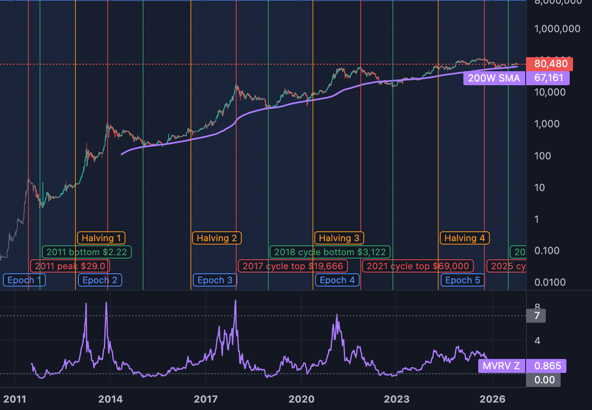

# Crows Chart

**A Bitcoin chart from 2010 to today with 87 clickable overlays.** Turn on halvings, QE/QT, rate hikes and cuts, elections, wars, crashes, on-chain metrics and price models, then see what BTC did before, during and after each one.

Made by **Crypto Crow** · [CryptoCrow.io](https://cryptocrow.io) · [YouTube: @cryptocrowofficial](https://www.youtube.com/@cryptocrowofficial)



## What it does

- **Full BTC history.** Daily candles from Bitstamp (Aug 2011 on). Before that, the CoinMetrics daily price (from Jul 2010), drawn as grey candles because no real open/high/low exists.
- **TradingView-style chart** built with [Lightweight Charts](https://github.com/tradingview/lightweight-charts): drag, zoom, stretch the price axis, resize the panels, switch between 1D/1W/1M and log/linear.
- **Left panel of overlays.** Click to turn each one on or off. There are three kinds:
  - **Event lines** for halvings, rate hikes, FTX and similar one-day events.
  - **Shaded periods** for QT, wars, recessions, midterm years and similar spans.
  - **Data lines** for Fed liquidity, MVRV, the 200-week MA and similar series, either on the price chart or in a panel below.
- **Evidence grade on every overlay:** **A** strong, **B** medium, **C** weak / folklore.
- **Before/after slider.** Shades N days before and after every event.
- **Compare table.** BTC % move before, during and after every instance, with the average and median. Rows that are in the future or still running are left out of the average.
- **Hover** over any line or period to see what it is and when it happened.
- **Free data only.** No API keys. FRED, CoinMetrics community, Bitstamp, blockchain.com, alternative.me and DefiLlama.
- **AI remote control (optional).** Run [Claude Code](https://claude.com/claude-code) in this folder and ask a question, for example "how does BTC act around midterms?" Claude answers on your chart. It turns on overlays, zooms in, draws boxes and leaves a note card (see `bin/chart.mjs`).

> Not financial advice. Correlation is not cause. Bitcoin has had only 4 halving cycles, so every pattern here rests on a few examples.

## Run it

You need [Node.js](https://nodejs.org) 20 or newer.

```bash
git clone https://github.com/CrowsCoder/crows-chart.git
cd crows-chart
npm install
npm start
```

Open http://127.0.0.1:5178. The first start downloads the data, which takes about 15 seconds. After that the data refreshes when it is more than 12 hours old, or when you click **Refresh data**.

On a Mac you can double-click **Start Crows Chart.command** instead.

## Public site

A free, non-commercial copy runs at **https://chart.cryptocrow.io**.
- A daily GitHub Action (`.github/workflows/publish.yml`) fetches fresh data, builds a static site (`npm run build:public`), and pushes it to the `site` branch.
- Cloudflare Pages publishes the `site` branch.
- The public site leaves out the Claude link and 5 overlays whose data terms don't allow public redistribution: Nasdaq, VIX, high-yield spread, stablecoins and difficulty. See `scripts/public-policy.json`.
- The data stays © its owners. Coin Metrics Community data is licensed [CC BY-NC 4.0](https://creativecommons.org/licenses/by-nc/4.0/), so do not use the public site or its JSON commercially.

## Commands

| Command | What it does |
|---|---|
| `npm start` | Start the local server (only on 127.0.0.1) |
| `npm run fetch` | Download fresh data now |
| `npm run build:public` | Build the static public site into `dist/` |
| `npm run docs` | Rebuild the overlay tables below and `docs/OVERLAYS.md` |
| `node bin/chart.mjs help` | Remote-control the open chart (used by Claude) |
| `node bin/chart.mjs stats midterms 365` | Print BTC % before/after every midterm, no browser needed |

## Overlays

Every overlay, what it shows and where its data comes from. For every date each overlay draws, see **[docs/OVERLAYS.md](docs/OVERLAYS.md)**. For the research list behind the app, see [docs/btc-price-drivers.md](docs/btc-price-drivers.md).

<!-- overlays:start -->
_87 overlays in 15 groups. Generated by `npm run docs`. Full dates for every overlay: [docs/OVERLAYS.md](docs/OVERLAYS.md)._

### Halving & 4-year cycle

| Overlay | Evidence | What it is | Shows | Data source |
|---|---|---|---|---|
| **Halvings** <br><sub>`halvings`</sub> | A | Block reward cut in half every 210,000 blocks (~4 years). | 5 event lines | Hand-curated dates (`public/js/events-data.js`) |
| **Halving epochs (4-year cycles)** <br><sub>`halving-epochs`</sub> | A | Shaded halving-to-halving periods. | 5 shaded periods | Halving dates |
| **Cycle tops** <br><sub>`cycle-peaks`</sub> | B | Highest price of each cycle, found in the data. | 5 event lines | Found in BTC price data (highest high in fixed date windows) |
| **Cycle bottoms** <br><sub>`cycle-bottoms`</sub> | B | Lowest price of each bear market, found in the data. | 5 event lines | Found in BTC price data (lowest low in fixed date windows) |
| **Halving → top runs** <br><sub>`halving-to-top`</sub> | B | Shaded run from each halving to the next cycle top. Shows the ~12–18 month pattern. | 4 shaded periods | Halving dates + cycle tops found in price data |
| **Days since halving** <br><sub>`days-since-halving`</sub> | B | Counter that resets at every halving. | Days since halving (panel below) | Computed from halving dates |
| **BTC supply inflation % (yearly)** <br><sub>`inflation`</sub> | A | New coins per year ÷ supply. Drops at each halving. | Supply inflation % (panel below) | CoinMetrics community API |
| **Stock-to-Flow model (PlanB 2019)** <br><sub>`s2f`</sub> | C | ln(market cap) = 3.3·ln(S2F) + 14.6. Model failed in 2021–22. Shown for reference. | S2F model price (line on price) | CoinMetrics community API |

### Central bank money (QE / QT)

| Overlay | Evidence | What it is | Shows | Data source |
|---|---|---|---|---|
| **QE periods (money printing)** <br><sub>`qe`</sub> | A | Fed buying bonds = adding money. Includes "Not-QE" and RMP. | 7 shaded periods | Hand-curated dates (`public/js/events-data.js`) |
| **QT periods (money draining)** <br><sub>`qt`</sub> | A | Fed shrinking its balance sheet = removing money. | 2 shaded periods | Hand-curated dates (`public/js/events-data.js`) |
| **Taper periods** <br><sub>`taper`</sub> | B | Fed slowing QE before stopping it. | 2 shaded periods | Hand-curated dates (`public/js/events-data.js`) |
| **Fed balance sheet ($T)** <br><sub>`fed-balance`</sub> | A | FRED WALCL. Rising = QE, falling = QT. | Fed balance sheet $T (line on its own scale) | FRED `WALCL` |
| **Fed net liquidity ($T)** <br><sub>`net-liquidity`</sub> | A | Balance sheet − Treasury account (TGA) − reverse repo. Tracks BTC closely since 2020. | Net liquidity $T (line on its own scale) | FRED `WALCL`, FRED `WTREGEN`, FRED `RRPONTSYD` |
| **Treasury General Account ($B)** <br><sub>`tga`</sub> | B | Government cash at the Fed. Rising TGA drains liquidity. | TGA $B (panel below) | FRED `WTREGEN` |
| **Reverse repo ($B)** <br><sub>`rrp`</sub> | B | Cash parked at the Fed. Draining RRP adds liquidity. | Reverse repo $B (panel below) | FRED `RRPONTSYD` |
| **US M2 money supply ($T)** <br><sub>`m2`</sub> | A | FRED M2SL, monthly. | US M2 $T (line on its own scale) | FRED `M2SL` |
| **US M2 growth % (yearly)** <br><sub>`m2-yoy`</sub> | A | Year-over-year change in M2. Negative in 2023 for the first time since the 1930s. | M2 YoY % (panel below) | FRED `M2SL` |
| ~~Global M2 (multi-country)~~ | — | Not included: No clean free daily source for China/EU/Japan M2 in USD. | — | Paid / blocked |

### Interest rates

| Overlay | Evidence | What it is | Shows | Data source |
|---|---|---|---|---|
| **Fed funds rate (upper target)** <br><sub>`fed-rate`</sub> | A | FRED DFEDTARU. | Fed funds upper % (panel below) | FRED `DFEDTARU` |
| **Rate hikes** <br><sub>`rate-hikes`</sub> | A | Each Fed hike, from the rate data. | 21 event lines | FRED `DFEDTARU` |
| **Rate cuts** <br><sub>`rate-cuts`</sub> | A | Each Fed cut, from the rate data. Includes 2020 emergency cuts. | 11 event lines | FRED `DFEDTARU` |
| **Hiking cycles** <br><sub>`hiking-cycles`</sub> | A | First to last hike of each run. | 2 shaded periods | FRED `DFEDTARU` |
| **Cutting cycles** <br><sub>`cutting-cycles`</sub> | A | First to last cut of each run. | 2 shaded periods | FRED `DFEDTARU` |
| **Zero-rate eras** <br><sub>`zirp`</sub> | B | Fed funds upper bound at 0.25% or below. | 2 shaded periods | FRED `DFEDTARU` |
| **Fed chair changes** <br><sub>`fed-chairs`</sub> | B | Yellen 2014, Powell 2018, Warsh 2026. | 4 event lines | Hand-curated dates (`public/js/events-data.js`) |
| **10Y real yield (TIPS)** <br><sub>`real-yield`</sub> | A | Higher real yield is usually bad for BTC and gold. | 10Y real yield % (panel below) | FRED `DFII10` |
| **Yield curve (10Y − 2Y)** <br><sub>`yield-curve`</sub> | B | Below 0 = inverted. Historic recession warning. | 10Y−2Y % (panel below) | FRED `T10Y2Y` |

### US politics

| Overlay | Evidence | What it is | Shows | Data source |
|---|---|---|---|---|
| **Presidential elections** <br><sub>`presidential`</sub> | B | Line on election day. Shaded campaign year (Jan 1 → election). | 5 event lines; 5 shaded periods | Hand-curated dates (`public/js/events-data.js`) |
| **Midterm elections** <br><sub>`midterms`</sub> | B | Line on election day. Shaded midterm year (Jan 1 → election). All 3 past midterms were near bear-market lows. | 5 event lines; 5 shaded periods | Hand-curated dates (`public/js/events-data.js`) |
| **Inaugurations** <br><sub>`inaugurations`</sub> | C | New president sworn in (Jan 20). | 5 event lines | Hand-curated dates (`public/js/events-data.js`) |
| **Presidential cycle years** <br><sub>`pres-cycle`</sub> | C | Stock-market theory: Year 1 post-election, Year 2 midterm (weakest), Year 3 pre-election (strongest), Year 4 election. | 19 shaded periods | Calendar: 4-year US presidential term |
| **Government shutdowns** <br><sub>`shutdowns`</sub> | C | Federal funding lapses. | 6 shaded periods | Hand-curated dates (`public/js/events-data.js`) |
| **US credit downgrades & debt ceiling** <br><sub>`downgrades`</sub> | C | S&P 2011, Fitch 2023, Moody's 2025, 2023 debt-ceiling deal. | 4 event lines | Hand-curated dates (`public/js/events-data.js`) |
| **Crypto policy & regulation** <br><sub>`policy`</sub> | B | China bans, futures launches, ETF approval, Strategic Reserve, GENIUS Act. | 14 event lines | Hand-curated dates (`public/js/events-data.js`) |

### Business cycle & macro

| Overlay | Evidence | What it is | Shows | Data source |
|---|---|---|---|---|
| **US recessions (NBER)** <br><sub>`recessions`</sub> | B | Official recession months. Only one (2020) since BTC began. | 2 shaded periods | FRED `USREC` |
| **US dollar index (broad)** <br><sub>`dollar`</sub> | A | FRED broad trade-weighted dollar. Moves like DXY. Strong dollar usually = weak BTC. | USD broad index (line on its own scale) | FRED `DTWEXBGS` |
| **Nasdaq Composite** <br><sub>`nasdaq`</sub> | A | Tech stocks. BTC often trades like a tech stock. | Nasdaq (line on its own scale) | FRED `NASDAQCOM` |
| **CPI inflation % (yearly)** <br><sub>`cpi`</sub> | B | Consumer prices, year over year. | CPI YoY % (panel below) | FRED `CPIAUCSL` |
| **Unemployment rate** <br><sub>`unemployment`</sub> | B | Rising unemployment often leads to rate cuts. | Unemployment % (panel below) | FRED `UNRATE` |
| **VIX (stock fear index)** <br><sub>`vix`</sub> | B | Spikes = panic in stocks. | VIX (panel below) | FRED `VIXCLS` |
| **High-yield credit spread** <br><sub>`hy-spread`</sub> | B | Risk appetite. FRED only gives the last ~3 years free. | HY spread % (panel below) | FRED `BAMLH0A0HYM2` |
| **Macro shocks** <br><sub>`macro-shocks`</sub> | B | Cyprus, Greece, yuan devaluation, Brexit, COVID, SVB, yen carry crash. | 9 event lines | Hand-curated dates (`public/js/events-data.js`) |
| ~~ISM Manufacturing PMI~~ | — | Not included: ISM removed it from FRED. Paid only. | — | Paid / blocked |

### Wars & geopolitics

| Overlay | Evidence | What it is | Shows | Data source |
|---|---|---|---|---|
| **Wars & conflicts (start → end)** <br><sub>`wars`</sub> | B | Shaded from start to end. Open-ended wars run to today. | 7 shaded periods | Hand-curated dates (`public/js/events-data.js`) |
| **Geopolitical shock days** <br><sub>`war-events`</sub> | B | Invasions, strikes, attacks, tariff shocks. | 17 event lines | Hand-curated dates (`public/js/events-data.js`) |

### Crypto news & crises

| Overlay | Evidence | What it is | Shows | Data source |
|---|---|---|---|---|
| **Crypto crises & milestones** <br><sub>`crypto-news`</sub> | B | Mt. Gox, FTX, Terra, Celsius, hacks, Tesla, forks, record liquidations. | 27 event lines | Hand-curated dates (`public/js/events-data.js`) |
| **FTX collapse** <br><sub>`ftx`</sub> | B | Withdrawals halted 2022-11-08. Bankruptcy 2022-11-11. Cycle bottom 10 days later. | 2 event lines | Hand-curated dates (`public/js/events-data.js`) |
| **Exchange failures & hacks** <br><sub>`exchange-failures`</sub> | B | Mt. Gox, Bitfinex, Coincheck, FTX, Bybit. | 11 event lines | Hand-curated dates (`public/js/events-data.js`) |

### Miners & hash power

| Overlay | Evidence | What it is | Shows | Data source |
|---|---|---|---|---|
| **Hash rate** <br><sub>`hashrate`</sub> | B | Total mining power (CoinMetrics). Follows price with a lag. | Hash rate (TH/s) (line on its own scale) | CoinMetrics community API |
| **Mining difficulty** <br><sub>`difficulty`</sub> | B | Adjusts every 2,016 blocks (~2 weeks). blockchain.com. | Difficulty (line on its own scale) | blockchain.com |
| **Hash Ribbons** <br><sub>`hash-ribbons`</sub> | B | 30-day vs 60-day hash rate average. Marker = 30d crosses back above 60d (miner capitulation over). Simplified version. | 40 event lines; Hash 30d (panel below); Hash 60d (panel below) | CoinMetrics community API |
| **Puell Multiple** <br><sub>`puell`</sub> | B | Miner issuance USD ÷ its 365-day average. Below 0.5 = bottom zone, above 4 = top zone. | Puell (panel below) | CoinMetrics community API |

### On-chain value

| Overlay | Evidence | What it is | Shows | Data source |
|---|---|---|---|---|
| **Realized price** <br><sub>`realized-price`</sub> | A | Average price every coin last moved at. Market cap ÷ MVRV ÷ supply. | Realized price (line on price) | CoinMetrics community API |
| **MVRV ratio** <br><sub>`mvrv`</sub> | A | Market value ÷ realized value. Below 1 = bottom zone, above 3.7 = top zone (history). | MVRV (panel below) | CoinMetrics community API |
| **MVRV Z-Score** <br><sub>`mvrv-z`</sub> | A | (Market cap − realized cap) ÷ std dev of market cap. Above 7 = top zone, below 0 = bottom zone. Did not reach 7 in 2025. | MVRV Z (panel below) | CoinMetrics community API |
| **NUPL (net unrealized profit/loss)** <br><sub>`nupl`</sub> | A | 1 − 1/MVRV. Below 0 = capitulation, above 0.75 = euphoria. | NUPL (panel below) | CoinMetrics community API |
| **Active addresses** <br><sub>`active-addresses`</sub> | B | Daily active addresses (CoinMetrics), 7-day average. | Active addresses 7d (panel below) | CoinMetrics community API |
| **Transactions per day** <br><sub>`tx-count`</sub> | C | On-chain transactions, 7-day average. | Tx/day 7d (panel below) | CoinMetrics community API |
| **Stablecoin supply ($B)** <br><sub>`stablecoins`</sub> | A | Total USD stablecoins (DefiLlama). "Dry powder" to buy crypto. | Stablecoins $B (line on its own scale) | DefiLlama |
| ~~SOPR / LTH supply / HODL waves~~ | — | Not included: Glassnode / CryptoQuant paid API. | — | Paid / blocked |
| ~~Exchange balances & netflows~~ | — | Not included: CryptoQuant / Glassnode paid API. | — | Paid / blocked |

### Price models

| Overlay | Evidence | What it is | Shows | Data source |
|---|---|---|---|---|
| **200-week moving average** <br><sub>`ma200w`</sub> | A | Historic bear-market floor. | 200W SMA (line on price) | Computed from BTC daily price |
| **Bull market support band** <br><sub>`bmsb`</sub> | A | 20-week SMA + 21-week EMA. Bull markets hold above it. | 20W SMA (line on price); 21W EMA (line on price) | Computed from BTC daily price |
| **Pi Cycle Top** <br><sub>`pi-cycle`</sub> | B | 111-day SMA crosses above 2× 350-day SMA = cycle top signal. Hit 2013, 2017, 2021. Not 2025. | 4 event lines; 111D SMA (line on price); 350D SMA ×2 (line on price) | Computed from BTC daily price |
| **2-year MA multiplier** <br><sub>`ma2y`</sub> | B | 2-year SMA (buy zone below) and 5× 2-year SMA (sell zone above). | 2Y SMA (line on price); 2Y SMA ×5 (line on price) | Computed from BTC daily price |
| **Golden Ratio Multiplier** <br><sub>`golden-ratio`</sub> | B | 350-day SMA × 1.6, 2, 3. | 350D SMA (line on price); 350D ×1.6 (line on price); 350D ×2 (line on price); 350D ×3 (line on price) | Computed from BTC daily price |
| **50 / 200-day MA (golden & death cross)** <br><sub>`ma50-200`</sub> | B | Markers on each golden cross and death cross. | 26 event lines; 50D SMA (line on price); 200D SMA (line on price) | Computed from BTC daily price |
| **Mayer Multiple** <br><sub>`mayer`</sub> | B | Price ÷ 200-day SMA. Below 0.8 cheap, above 2.4 hot. | Mayer (panel below) | Computed from BTC daily price |
| **Power law (fitted)** <br><sub>`power-law`</sub> | B | log(price) vs log(days since genesis), fitted to this chart's own data. Bands = 1st and 99th percentile. | Power law fit (line on price); Power law floor (line on price); Power law ceiling (line on price) | Computed from BTC daily price |
| **Weekly RSI (14)** <br><sub>`rsi-weekly`</sub> | B | Above 70 overbought, below 30 oversold. | Weekly RSI (panel below) | Computed from BTC daily price |
| **Daily RSI (14)** <br><sub>`rsi-daily`</sub> | B | Above 70 overbought, below 30 oversold. | Daily RSI (panel below) | Computed from BTC daily price |
| **Realized volatility (30d)** <br><sub>`volatility`</sub> | B | Yearly-scaled 30-day volatility. Low vol often comes before a big move. | Vol 30d % (panel below) | Computed from BTC daily price |
| **Volume (Bitstamp)** <br><sub>`volume`</sub> | B | Bitstamp BTC volume. Only one exchange, so a sample, not the whole market. | Volume BTC (panel below) | Computed from BTC daily price |

### Flows & big holders

| Overlay | Evidence | What it is | Shows | Data source |
|---|---|---|---|---|
| **Spot ETF era** <br><sub>`etf-era`</sub> | A | US spot BTC ETFs trading since 2024-01-11. | 1 event line; 1 shaded period | Hand-curated date |
| **Corporate & government buyers** <br><sub>`corporate`</sub> | B | MicroStrategy, Tesla, El Salvador, US Strategic Reserve. | 5 event lines | Hand-curated dates (`public/js/events-data.js`) |
| **Big sellers (Mt. Gox, governments)** <br><sub>`supply-overhang`</sub> | B | German government sales and Mt. Gox repayments in 2024. | 1 event line; 1 shaded period | Hand-curated dates (`public/js/events-data.js`) |
| ~~Spot ETF daily flows~~ | — | Not included: No free API (Farside is a web page only). | — | Paid / blocked |
| ~~Coinbase premium~~ | — | Not included: CryptoQuant paid API. | — | Paid / blocked |

### Derivatives & leverage

| Overlay | Evidence | What it is | Shows | Data source |
|---|---|---|---|---|
| **Big liquidation crashes** <br><sub>`liquidations`</sub> | B | Days when leverage got wiped out. | 6 event lines | Hand-curated dates (`public/js/events-data.js`) |
| **Quarterly options expiry** <br><sub>`opex-q`</sub> | B | Last Friday of Mar/Jun/Sep/Dec (Deribit, 08:00 UTC). From 2017. | 44 event lines | Computed: last Friday of Mar/Jun/Sep/Dec |
| **Monthly options expiry** <br><sub>`opex-m`</sub> | C | Last Friday of every month (Deribit). From 2017. | 132 event lines | Computed: last Friday of each month |
| **Futures & leverage milestones** <br><sub>`cme-launch`</sub> | B | CBOE/CME futures, first futures ETF. | 3 event lines | Hand-curated dates (`public/js/events-data.js`) |
| ~~Funding rates & open interest history~~ | — | Not included: Binance/Bybit block US; others keep only ~3 months free. | — | Paid / blocked |
| ~~Liquidation heatmap~~ | — | Not included: Coinglass paid API. | — | Paid / blocked |

### Sentiment & market structure

| Overlay | Evidence | What it is | Shows | Data source |
|---|---|---|---|---|
| **Fear & Greed Index (alternative.me)** <br><sub>`fear-greed`</sub> | B | Source: Alternative.me Crypto Fear & Greed Index (alternative.me), from Feb 2018. Below 25 extreme fear, above 75 extreme greed. | Fear & Greed · Source: alternative.me (panel below) | alternative.me |
| **ETH/BTC ratio** <br><sub>`eth-btc`</sub> | B | Bitstamp, from Aug 2017. Rising = altcoin risk appetite. | ETH/BTC (panel below) | Bitstamp ETH/BTC |
| ~~Google Trends~~ | — | Not included: No official free API. | — | Paid / blocked |
| ~~BTC dominance history~~ | — | Not included: CoinGecko history needs a paid key. | — | Paid / blocked |

### Seasonality

| Overlay | Evidence | What it is | Shows | Data source |
|---|---|---|---|---|
| **Every September** <br><sub>`septembers`</sub> | C | Historically weak month. | 17 shaded periods | Calendar |
| **Every October ("Uptober")** <br><sub>`octobers`</sub> | C | Historically strong month. | 17 shaded periods | Calendar |
| **Every Q4** <br><sub>`q4`</sub> | C | Oct–Dec. | 17 shaded periods | Calendar |
| **Weekends** <br><sub>`weekends`</sub> | C | Thin liquidity. Best on the daily chart. | 849 shaded periods | Calendar |
| **US tax day (Apr 15)** <br><sub>`tax-day`</sub> | C | Tax selling folklore. | 17 event lines | Calendar |
| **Quarter ends** <br><sub>`quarter-ends`</sub> | C | Fund rebalancing dates. | 64 event lines | Calendar |

### Long waves & folklore

| Overlay | Evidence | What it is | Shows | Data source |
|---|---|---|---|---|
| **Benner cycle (1875 card)** <br><sub>`benner`</sub> | C | Folklore: panic years, good times (sell), hard times (buy). For curiosity only. | 8 event lines | Samuel Benner 1875 cycle card |
| **Full moons** <br><sub>`full-moons`</sub> | C | Fringe. No solid proof of any effect. ±1 day accuracy. | 215 event lines | Computed: mean lunar cycle from a known new moon (±1 day) |
| **New moons** <br><sub>`new-moons`</sub> | C | Fringe. No solid proof of any effect. ±1 day accuracy. | 216 event lines | Computed: mean lunar cycle from a known new moon (±1 day) |

<!-- overlays:end -->

## How it works

| Path | Role |
|---|---|
| `public/js/catalog.js` | Every overlay: id, group, grade, description, `build()` |
| `public/js/events-data.js` | Hand-curated event dates (fact-checked October 2026) |
| `public/js/calc.js` | Math: moving averages, RSI, resampling, power-law fit, compare stats |
| `public/js/overlay-primitive.js` | Draws event lines and shaded periods on the chart |
| `public/js/app.js` | UI, panel, compare table, remote-control commands |
| `server/server.mjs` | Local static server plus a Server-Sent Events bridge for remote commands |
| `server/fetch-data.mjs` | Downloads all free data into `data/` (not committed) |

To add an overlay, add an entry to `ITEMS` in `catalog.js`, then run `npm run docs`.

## Data sources and credits

- BTC candles: [Bitstamp](https://www.bitstamp.net/api/)
- Early price, MVRV, supply, hash rate, addresses: [CoinMetrics community API](https://docs.coinmetrics.io/)
- Fed, rates, M2, dollar, CPI, Nasdaq, VIX, recessions: [FRED](https://fred.stlouisfed.org/), St. Louis Fed
- Difficulty: [blockchain.com](https://www.blockchain.com/explorer/charts)
- Fear & Greed: [alternative.me](https://alternative.me/crypto/fear-and-greed-index/)
- Stablecoins: [DefiLlama](https://defillama.com/stablecoins)
- Chart engine: [TradingView Lightweight Charts](https://github.com/tradingview/lightweight-charts) (Apache-2.0)

Each source has its own terms of use. This repo ships code only. Data downloads to your machine when you run the app.

## License

MIT. See [LICENSE](LICENSE).

---

Built by **Crypto Crow**. More at [CryptoCrow.io](https://cryptocrow.io) and on [YouTube](https://www.youtube.com/@cryptocrowofficial).
